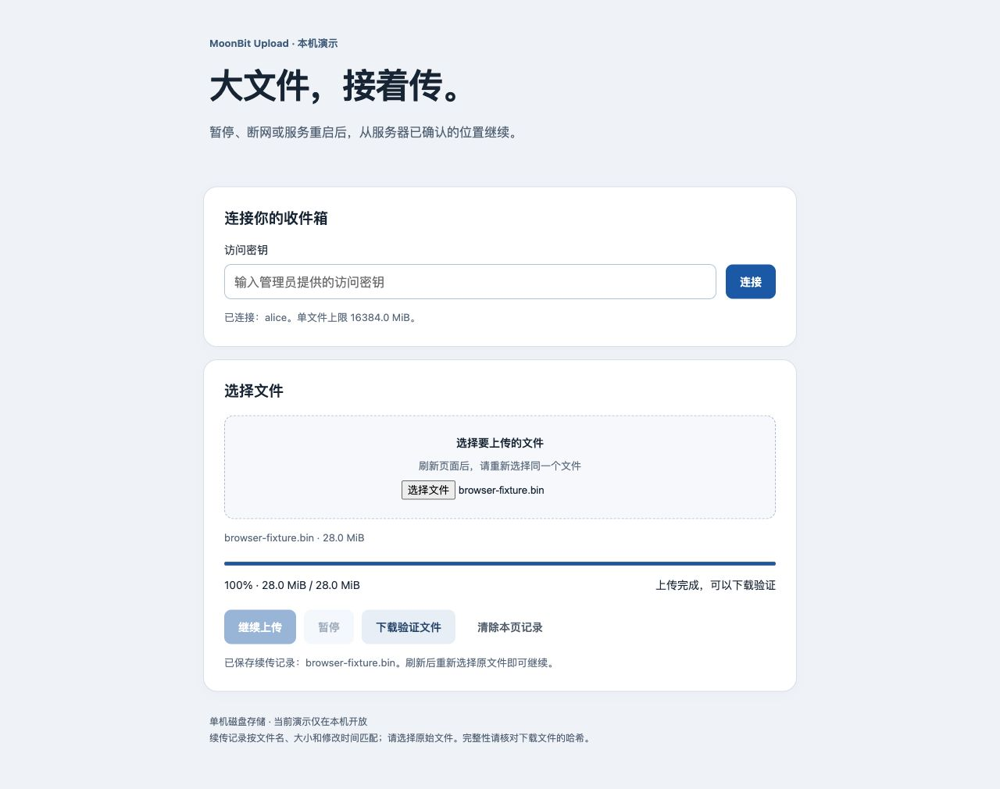

# MoonRelay — MoonBit 可靠文件传输库与 CLI

把大文件传到另一台电脑，或从远端取回结果。MoonRelay 提供进度显示、SSH 双向断点续传和 SHA-256 校验，也提供可在 MoonBit 应用中直接调用的传输接口。

适合你能登录、能安装程序的 macOS / Linux 机器：例如上传数据集到计算服务器、取回模型和实验结果，或在两台电脑之间传送大文件。SSH 登录和加密使用系统 OpenSSH；分块、恢复状态与内容校验由 MoonBit 实现。

## 安装

当前版本 **0.4.0**。从 [Release 页面](https://github.com/kaigeliang/moonbit-upload/releases/tag/v0.4.0) 下载 macOS ARM64、Linux x86_64 或 Windows x86_64 包及 SHA256SUMS，校验后完整解压，进入包根目录运行：

    ./bin/moonrelay --version

Windows 使用 ./bin/moonrelay.exe。保留 bin/ 与 web/ 目录；HTTP serve 当前需要从包根目录运行。运行安装包不需要 MoonBit、Python 或 Node；SSH 需要系统 OpenSSH。

源码构建需要 Git 和 MoonBit CLI；已验证的 CLI 版本为 0.1.20261012：

```sh
git clone https://github.com/kaigeliang/moonbit-upload.git
cd moonbit-upload
moon update
tools/build-cli.sh
./bin/moonrelay --version
```

运行构建后的 CLI 不需要 MoonBit、Python 或 Node。SSH 传输需要**两端分别安装**支持相同协议能力的 `moonrelay`，macOS 二进制不能直接用于 Linux。先确认普通 SSH 登录可用，并已配置密钥和主机信任；CLI 不进行密码交互。

下面的例子假设远端程序位于 `/home/user/moonbit-upload/bin/moonrelay`，远端 `/data` 目录已存在且可写。请换成自己的账号、机器和路径。

打包脚本、解压验证和三端发布工作流见 [安装包构建说明](docs/releases.md)。

## 上传大文件

```sh
./bin/moonrelay push ./dataset.zip user@host:/data/dataset.zip \
  --remote-bin /home/user/moonbit-upload/bin/moonrelay
```

终端显示进度；连接中断会自动重试。退出终端或接收进程被终止后，**重跑同一条命令**继续传输。请保留原文件内容，以及目标旁的 `dataset.zip.moonrelay/` 恢复目录。

接收完成后会核对完整 SHA-256，校验通过才生成最终文件。已有同名文件默认拒绝覆盖；本工具已完成且内容仍匹配的文件可以复用。

## 下载结果

```sh
./bin/moonrelay pull user@host:/data/model.bin ./model.bin \
  --remote-bin /home/user/moonbit-upload/bin/moonrelay
```

SSH 下载同样支持断点恢复。中断后重跑命令，保留本地 `model.bin.moonrelay/`，远端源文件内容须保持一致。

## 查进度、核对文件

```sh
# 查看上传目标状态
./bin/moonrelay status user@host:/data/dataset.zip \
  --remote-bin /home/user/moonbit-upload/bin/moonrelay

# 查看本工具下载任务的本地状态
./bin/moonrelay status ./model.bin

# 计算任意本地文件的 SHA-256
./bin/moonrelay hash ./model.bin

# 与你事先保存的可信哈希比较；替换 TRUSTED_SHA256 为实际哈希
./bin/moonrelay verify ./model.bin --sha256 TRUSTED_SHA256
```

远端 `verify` 也可使用 `--remote-bin`。远端程序已在 PATH 中时可省略该参数；已有 SSH 配置可通过 `--ssh-config FILE` 使用。进度写入 stderr，传输回执与 SSH 状态以 JSON 写入 stdout（`hash` 返回纯哈希，HTTP `verify` 返回文本），方便脚本读取。[完整命令与恢复说明](docs/moonrelay.md)。

## HTTP 上传与浏览器演示

需要浏览器选文件上传时，可以运行本机 HTTP 服务。先设置用户密钥（每个密钥为随机生成的 64 位小写十六进制字符串）：

```sh
export MOON_UPLOAD_KEYS='{"alice":"替换为实际随机密钥"}'
./bin/moonrelay serve ./data 4176
```

打开 <http://127.0.0.1:4176>，输入密钥并选择文件。可以暂停、继续；刷新或重启服务后，需要重新输入密钥并选择原文件。上述密钥占位内容必须替换才能启动服务。



CLI 也能访问这个服务：

```sh
export MOON_UPLOAD_KEY='替换为同一用户的实际密钥'
./bin/moonrelay push ./dataset.zip http://127.0.0.1:4176
# 用上传结果中的实际资源地址替换 /files/12
./bin/moonrelay pull http://127.0.0.1:4176/files/12 ./copy.zip \
  --receipt ./dataset.zip.moon-upload.json
```

HTTP 上传与 CLI 下载支持断点恢复；下载中断后，保留目标旁的 `.part` 和 `.part.json`，重跑同一命令继续，最终核对完整 SHA-256。浏览器下载验证限制为 128 MiB；更大文件使用 CLI。HTTP 服务固定监听本机回环地址。权限、密钥和配置见 [HTTP 使用说明](docs/cli.md) 与 [访问控制说明](docs/api.md)。

## 在 MoonBit 应用中使用

公共 `kaigeliang/upload/transfer` 包提供 `push`、`pull`、`status`、`verify`、`hash_file` 和进度回调，供应用直接传文件；`storage`、`httpclient`、`sha256` 提供存储与 HTTP 集成接口，当前面向 native 目标。

查看 [API 与接入示例](docs/moonrelay.md#公共-api) 和 [独立调用项目](examples/library-consumer)。尚未发布 Mooncakes，示例通过本地 workspace 接入源码。

## 任务与空间管理

用 moonrelay tasks ./results 查看任务、恢复文件占用和可回收字节数；用 moonrelay clean ./results/model.bin 校验最终文件后回收重复分块。HTTP 仓库的显式删除、锁保护和完整命令见[维护说明](docs/maintenance.md)。

## 使用前了解这些限制

- SSH 已增加 `--recursive` 目录传输，支持逐文件恢复和空目录，见[目录说明](docs/moonrelay.md#目录断点续传)。没有删除同步、云存储或中继功能。Windows 客户端的验证范围见下方。
- 接收端保留分块和最终文件，成功传输约需文件大小 **2 倍磁盘空间**；可用 clean 显式清理已完成任务的重复分块。
- SSH 每个协议请求启动一个 SSH 进程，可以沿用 OpenSSH 连接复用配置；尚无吞吐率对比结论。
- 已验证本机及 Linux CI 中真实 OpenSSH 回环传输，以及 **macOS→Linux / Linux→macOS 的 1.25 GiB 跨机器双向中断续传与最终哈希**。尚未验证断电恢复。16 GiB 是单文件配置上限。
- 进程中断可以恢复，持久化目录损坏或内容身份不匹配会报错；SSH 接收端使用登录账号的文件权限。

[Linux 功能验证](https://github.com/kaigeliang/moonbit-upload/actions/runs/38860963811)覆盖大文件、故障恢复及独立库调用。

Apache-2.0。MoonBit 传输与存储逻辑独立实现；SSH 使用系统 OpenSSH。协议参考范围、依赖及许可证见 [参考来源与第三方说明](docs/references.md)。

## Windows 客户端

Windows 原生构建、11 项单元测试、盘符路径、64 MiB HTTP 上传下载、HTTP 断点恢复及任务维护已通过 [功能 CI](https://github.com/kaigeliang/moonbit-upload/actions/runs/38860963811)。SSH 远端仍使用 macOS / Linux。需要系统 OpenSSH 客户端；源码构建需要 MoonBit 与 MSVC C++ Build Tools / Windows SDK（见 [MoonBit 官方说明](https://docs.moonbitlang.com/en/latest/toolchain/moon/package.html)）。在开发者 PowerShell 中运行：

```powershell
moon update
./tools/build-cli.ps1
./bin/moonrelay.exe hash 'C:\data\dataset.zip'
./bin/moonrelay.exe push 'C:\data\dataset.zip' user@host:/data/dataset.zip --remote-bin /home/user/bin/moonrelay
./bin/moonrelay.exe pull user@host:/data/model.bin 'C:\data\model.bin' --remote-bin /home/user/bin/moonrelay
```

本地路径可使用 Windows 盘符。Windows 作为 SSH 接收端尚未支持；远端可执行文件的引用规则针对 Unix shell。Windows CI 检查原生构建、哈希、本地路径和 HTTP 上传下载；Windows 到 Unix 的真实 SSH 传输尚待验证。

Windows 正式安装包和校验文件见 [0.4.0 Release](https://github.com/kaigeliang/moonbit-upload/releases/tag/v0.4.0)。Windows 到 Linux 的实机 SSH 验证保留待验证。
