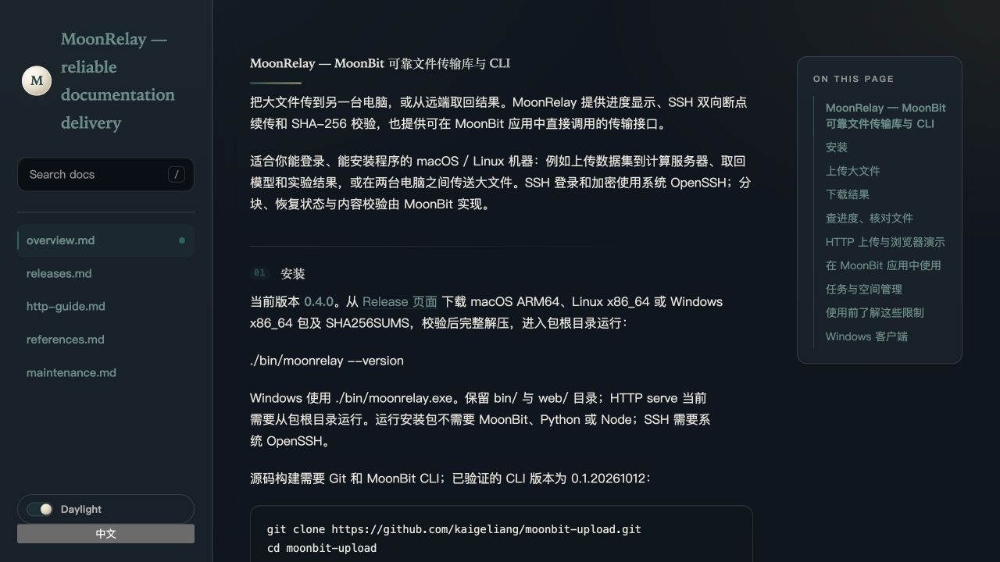

# MoonDocKit × MoonRelay：构建完成后，可靠交付文档站

## 场景与价值

MoonDocKit 是第三方 MoonBit 文档工具库。包作者可以先用它生成多页面文档站，再由自己的发布应用将产物交付到可通过 SSH 登录的 Linux 机器。应用直接调用 MoonRelay 的库接口，获得持久恢复、进度回调、最终校验和结构化回执，不需要在业务代码中重新实现分块与恢复逻辑。

本案例由 MoonRelay 项目实现。它使用真实第三方库及真实文档，验证了集成可行性；没有联系上游作者，也不声称存在第三方用户采用、上游认可或生产部署。

## 两个真实库在同一应用中运行


消费者位于仓库外的独立目录，无 moon.work 或本地路径覆盖。从 Mooncakes 安装：

```text
examples/docsite_delivery
├── Estrella-11/moondockit@0.6.0
├── kaigeliang/upload@0.4.0
└── moonbitlang/async@0.22.4
```

[集成程序](../../examples/docsite-delivery/main.mbt)在 native 目标中调用 MoonDocKit 的 build_site_manifest、validate_site 等公共接口，随后直接调用 MoonRelay 的 push、verify、pull。Python 仅负责可复现运行、SIGKILL 故障注入与独立哈希核验，不替代这两个库的核心功能。

## 实测流程

1. 读取 README、HTTP、维护、发布、参考来源这五份真实文档，生成完整站点。
2. 将第一个站点文件发送到 Linux 并执行远端完整校验；检查点落盘后，驱动对消费者进程组发送 SIGKILL。
3. 使用相同站点和远端目录重跑：先前完成文件返回完整偏移，进度推进字节数为零，继续交付其余文件。
4. 通过 pull 取回所有文件。Python 在本地与 Linux 分别计算 SHA-256，与生成时的清单逐项比较，并确认文件集合完全相同。
5. 浏览器打开实际取回的站点，检查首页、导航及正文。

本次站点较小，故障发生在两个文件之间。这证明批次重跑及已完成文件复用；大文件中途分块恢复的证据仍引用 [1.25 GiB 实机验证](../evidence/cross-machine-0.4.0-20261016.json)，不混用两种结论。

2026-10-17（北京时间）的干净提交实测：5 页文档，11 个站点文件，共 209214 字节；首个文件重跑初始偏移 365/365 字节，进度推进 0 字节；全部 11 个文件三处哈希一致。实测实现提交为 `cfabd8c301f7c58fd4960d360f76d6471a6982f4`。MoonDocKit 内部质量检查通过。

运行回执：[docsite-delivery-20261017.json](../evidence/docsite-delivery-20261017.json)。回执列出依赖版本、应用源码与输入文档哈希、每个输出文件长度及 SHA-256、故障位置、重跑偏移和验证步骤。最终实测数值以该回执为准。



## 复现

按 [示例 README](../../examples/docsite-delivery/README.md) 准备 SSH 登录、远端 MoonRelay、Python 3 和 MoonBit native 工具链，然后在主仓库运行：

```sh
python3 tools/docsite-case.py --host user@host \
  --remote-parent /absolute/existing/writable/directory \
  --remote-bin /absolute/remote/bin/moonrelay \
  --ssh-config /absolute/ssh_config
```

所有输出保留在新建的 output/docsite-UTC时间/ 中。`site/` 是原始构建产物，`returned/` 是真实取回产物；`verification.json`、`expected-files.json`、`resume-delivery.log` 提供证据。不要在对外分享时附带 SSH 私钥、全局配置或本机私有路径。公开回执仅包含必要结果。

## 使用范围

这份集成示例用于文档和其他构建产物交付，不提供整站原子切换或线上托管。使用前需要安装兼容的远端程序并配置 SSH 与目录权限。小型站点的批次恢复与大文件分块续传应分别验证。MoonDocKit 的质量分属于内部规则检查。

来源：[MoonDocKit 仓库](https://github.com/Estrella-11/moonbit_1)、[0.6.0 注册表版本](https://mooncakes.io/docs/Estrella-11/moondockit@0.6.0)。上游参考提交为 9b937684f4bc9a649acbe2fda16e4fa3eeb9c48b，许可证 Apache-2.0。实际执行以注册表包源码哈希为准；不将上游代码计为 MoonRelay 新增贡献。
