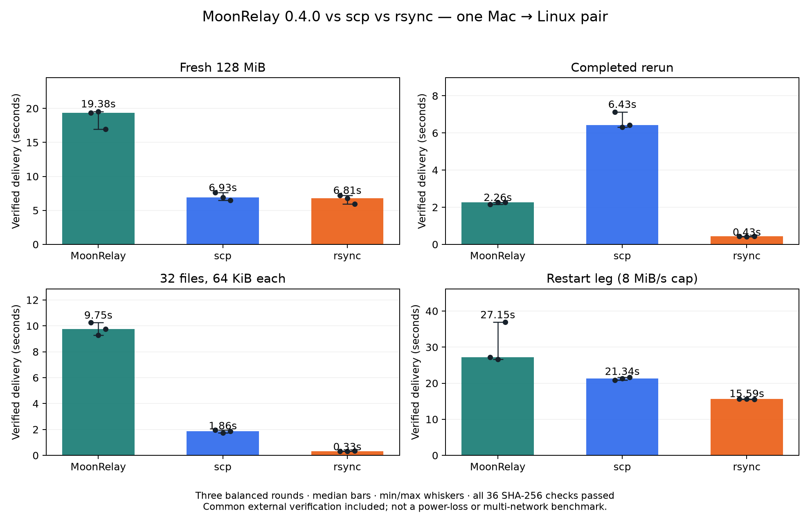

# MoonRelay 0.4.0、scp 与 rsync 的实机对照

测试日期：2026-10-17（北京时间）。所有数字仅代表本次同一台 macOS ARM64 发送端与 Linux x86_64 接收端，不外推为普遍性能排名。

## 结果与选型

本次首次大文件传输和小文件目录传输中，scp 与 rsync 比 MoonRelay 更快；rsync 在已完成内容重跑方面也更快。MoonRelay 和 rsync 都能利用保留状态减少恢复/重跑传输量；scp 的相同命令重跑重新发送完整文件。MoonRelay 的用途是为 MoonBit 应用提供可直接组合的传输接口、持久恢复和完成回执；本结果不支持“比 rsync 更快”的宣传。



## 公平性与测量口径

- 同一输入、同一发送端和接收端、同一预热 SSH ControlMaster、同一 aes128-gcm@openssh.com、压缩关闭。工具采用公开发布版本；MoonRelay 客户端和接收端二进制 SHA-256 存在结果 JSON 中。
- 确定性 SHAKE-256 伪随机数据：128 MiB 单文件；32 个 64 KiB 文件，分布于四个子目录。只比较内容和相对路径，不比较属主、时间戳、硬链接或符号链接语义。
- 每场景三轮，顺序依次为 MoonRelay/scp/rsync、scp/rsync/MoonRelay、rsync/MoonRelay/scp，使用全新目标。源和系统缓存未特权清空；共享服务器背景负载未隔离。接收端 /tmp 位于 NVMe 根文件系统，试验前可用空间约 4.3 GiB；每项核验后只清理本次专用目录，避免后续试验累积占用。
- 首次、完成重跑及目录场景无额外速率上限；中断场景所有工具统一经过同一 8 MiB/s 发送上限代理，代理观测到本次发送达到 32 MiB 加密 SSH 流字节时立即终止发送进程组，所有工具使用同一回调。实际保留前缀会因分块提交与在途缓冲而不同，逐轮报告，不假装三者中断点完全相同。
- rsync 使用 `-rt --partial-dir=.rsync-partial --no-whole-file --no-compress --stats`，保留其正常增量和恢复能力；scp 使用当前 OpenSSH 的默认 SFTP 传输，不强制旧协议。MoonRelay 使用正常 push/--recursive；其内部哈希及提交成本保留。
- 所有成功命令后，用相同 Python 程序对接收内容执行独立 SHA-256 并比较文件集合。主表分别列工具耗时和“工具＋共同核验”两段耗时之和；不计计数器收尾的 0.1 秒等仪器开销，不冒充包含所有驱动操作的端到端墙钟。该共同核验不为 MoonRelay 额外调用 status。rsync 本身也有传输校验，不能描述为“没有校验”。未为 scp/rsync 强制添加与 MoonRelay 相同的逐块 fsync；因此不比较同等断电持久性。
- 流量为同一个环回 TCP 计数代理观测到的加密 SSH 流字节，排除独立探测/核验连接与最初 SSH 握手。不含 TCP/IP 头或 TCP 重传，也不是磁盘文件长度的推算。
- 内存是发送端进程组 RSS 的采样最大值（约 100ms 加 ps/probe 开销），不含预先存在的共用 SSH master；不是发送端与接收端总内存或精确峰值。短于 0.2 秒的样本在主表标为“采样不足”，不拿漏采的低值作内存优势结论；原始数字仍保留在 JSON/CSV。空间是核验完成后接收端常规文件的逻辑字节与实际分配块，不含目录 inode 等元数据，也非峰值空间。

## 三轮结果

秒数为中位数（最小–最大）；SSH MiB、采样 RSS MiB、保留空间 MiB 为三轮中位数。不同场景使用独立纵轴；中断重跑场景有单独速率配置，不与不限速首次时间直接算提速倍数。首次、完成重跑和小文件的 27 项来自同一基础测量段；恢复的 9 项来自统一字节触发的补测段。旧的接收端探测中断记录因观测延迟导致断点不一致，仅留作本地诊断，不纳入恢复统计；两个测量段的代码指纹均保存在 JSON 中。

| 场景 | 工具 | 工具秒 | 含共同核验秒 | 发送 SSH MiB | 采样 RSS MiB | 接收端保留 MiB |
| --- | --- | --- | --- | --- | --- | --- |
| 首次上传 128 MiB | MoonRelay | 19.046 (16.646–19.248) | 19.376 (16.953–19.558) | 128.158 | 14.66 | 256.001 |
| 首次上传 128 MiB | scp | 6.624 (6.188–7.299) | 6.928 (6.495–7.602) | 128.523 | 5.97 | 128.000 |
| 首次上传 128 MiB | rsync | 6.509 (5.664–6.897) | 6.812 (5.970–7.211) | 128.591 | 8.02 | 128.000 |
| 完成后重跑 128 MiB | MoonRelay | 1.951 (1.847–1.970) | 2.255 (2.154–2.269) | 0.001 | 7.36 | 256.001 |
| 完成后重跑 128 MiB | scp | 6.123 (6.019–6.833) | 6.431 (6.324–7.136) | 128.479 | 6.02 | 128.000 |
| 完成后重跑 128 MiB | rsync | 0.128 (0.110–0.132) | 0.434 (0.421–0.437) | 0.001 | 采样不足 | 128.000 |
| 32 × 64 KiB 小文件目录 | MoonRelay | 9.655 (9.170–10.155) | 9.750 (9.268–10.249) | 2.117 | 7.20 | 4.011 |
| 32 × 64 KiB 小文件目录 | scp | 1.761 (1.664–1.869) | 1.857 (1.745–1.954) | 2.020 | 5.45 | 2.000 |
| 32 × 64 KiB 小文件目录 | rsync | 0.238 (0.234–0.290) | 0.325 (0.323–0.363) | 2.009 | 8.02 | 2.000 |
| 中断后的重跑阶段（8 MiB/s 发送上限） | MoonRelay | 26.843 (26.267–36.580) | 27.150 (26.584–36.891) | 96.119 | 14.52 | 256.001 |
| 中断后的重跑阶段（8 MiB/s 发送上限） | scp | 21.027 (20.519–21.348) | 21.343 (20.830–21.653) | 128.532 | 6.02 | 128.000 |
| 中断后的重跑阶段（8 MiB/s 发送上限） | rsync | 15.283 (15.259–15.307) | 15.588 (15.565–15.683) | 94.853 | 8.58 | 128.000 |

## 中断恢复的实际保留量

“中断＋恢复总秒”相加两次工具运行及最终共同核验，不含两次运行之间人为等待的 1 秒及额外状态探测；中断运行期间的观测开销仍包含其中。不作为整项任务的墙钟总时长。scp 即使留下可见部分文件，相同命令仍重新传输。rsync 使用保留的部分文件作为增量基准；MoonRelay 使用已提交偏移。

| 工具 | 中断后保留进度 MiB 范围 | 重跑发送 SSH MiB 中位数 | 中断＋恢复运行秒中位数 |
| --- | --- | --- | --- |
| MoonRelay | 32.00–32.00 | 96.12 | 33.411 |
| scp | 33.37–33.62 | 128.53 | 26.507 |
| rsync | 33.59–33.78 | 94.85 | 20.717 |

MoonRelay 首次完成后约保留两份内容。另做一次显式 `clean`：耗时 1.405 秒，逻辑空间降至 128.000 MiB，最终文件独立 SHA-256 仍通过。该额外清理未偷偷算入其他工具的完成时间，也未从 MoonRelay 初始占用中扣除。

## 复现和原始数字

[完整去标识结果 JSON](benchmarks/transfer-comparison-20261017.json)、[逐轮 CSV](benchmarks/transfer-comparison-20261017.csv)、[复现驱动](../tools/compare-transfers.py)。JSON 含驱动指纹、二进制指纹、输入清单、逐轮输出哈希和实际中断状态；主机别名与本机目录已替换为占位符。

```sh
python3 tools/compare-transfers.py --host user@host --ssh-config /absolute/ssh_config \
  --remote-parent /absolute/existing/writable/directory \
  --remote-bin /absolute/remote/moonrelay --cli /absolute/local/moonrelay \
  --rsync /absolute/local/rsync --output /absolute/new/results
```

需要 Python 3、OpenSSH、nc 和两端 rsync/MoonRelay。TCP 字节代理目前要求 SSH 配置为直连（无 ProxyJump/ProxyCommand）；检测到代理/跳板会明确停止，不绕过原路由。脚本仅创建随机命名的实验目录，在每项完成并核验后清理该项，输出目录和原始日志留在本地。三轮完整运行可能传输数 GiB，请在自己的空闲测试环境复现。

版本信息：

```text
client_platform: macOS-27.0-arm64-arm-64bit-Mach-O
ssh: OpenSSH_10.3p1, LibreSSL 3.3.6
scp: OpenSSH scp, default SFTP transport
rsync_client: rsync  version 3.5.0  protocol version 32
receiver: Linux x86_64
rsync_receiver: rsync  version 3.2.7  protocol version 31
moonrelay_client: moonrelay 0.4.0
moonrelay_receiver: moonrelay 0.4.0
cli_sha256: 8f8a0b2d64e5c4155d50383f34691e824ca6ec2442120c4e2e4edca7095efac0
receiver_cli_sha256: d0771ae64f43eb55a3406e20e98d78148d4a6d43af4158d6e430afdc9f2dc709
```

参考：[rsync 官方手册](https://download.samba.org/pub/rsync/rsync.1)、[OpenSSH scp 手册](https://man.openbsd.org/scp)、[SSH 复用配置](https://man.openbsd.org/ssh_config)。
